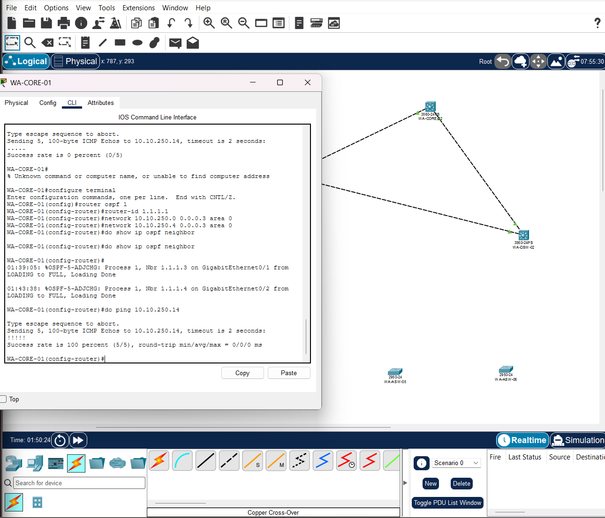
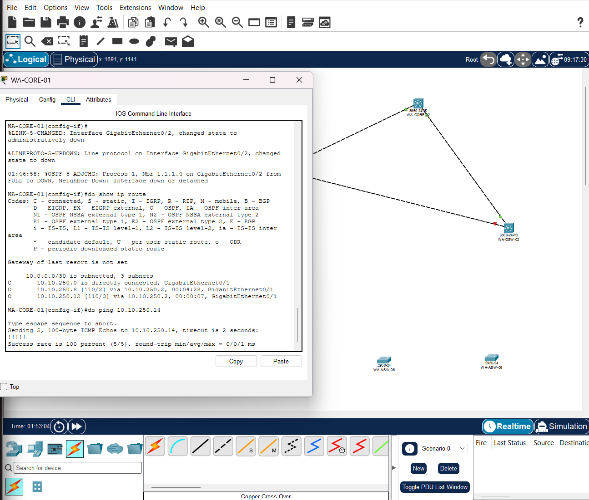
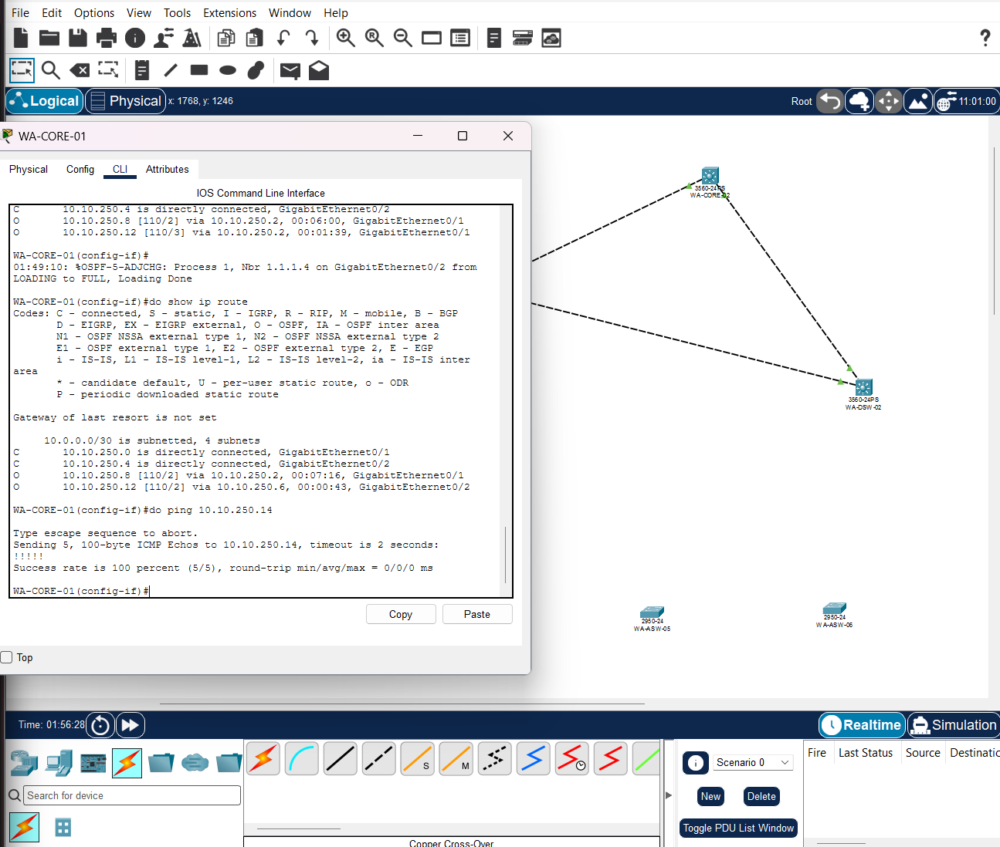
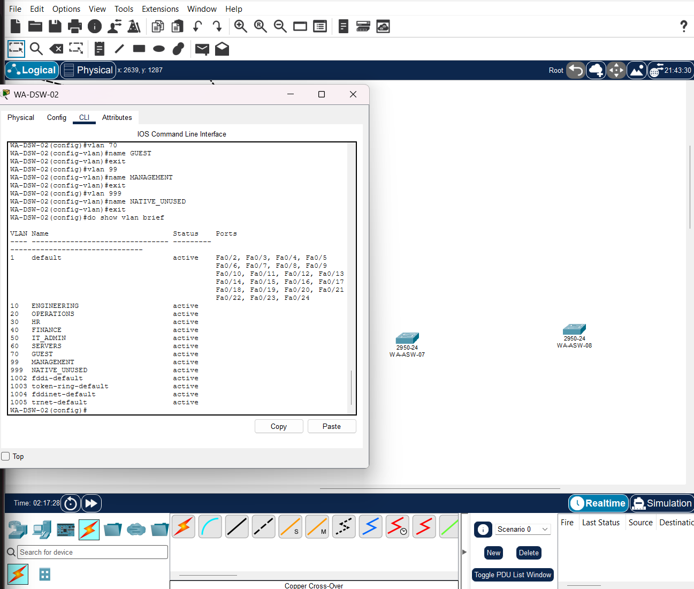

# Multi-State Secure Enterprise Network

Design, implementation, and security of a multi-state Cisco enterprise network connecting three geographically distributed offices.

**Status:** Phase 2 — Washington headquarters implementation in progress. All four core-to-distribution routed links and OSPF Area 0 configured and tested; controlled OSPF failover and preferred route recovery verified; final recovery ping verified 5/5. Routing configuration saves confirmed by user. Phase 2B: first access-switch dual trunks verified; nine VLANs created on WA-DSW-02. Step 48 completed on WA-ASW-01: VTP Transparent verified by user; distribution switches pending.

## Overview

This personal engineering lab models the infrastructure of a fictional enterprise. The objective is to gain practical experience designing, implementing, securing, monitoring, and troubleshooting a realistic multi-site network.

| Site | Role | Target users (simulated) | Proposed address block |
| --- | --- | ---: | --- |
| Seattle, Washington | Headquarters and data center | 300 | 10.10.0.0/16 |
| San Jose, California | Regional engineering office | 150 | 10.20.0.0/16 |
| Austin, Texas | Regional operations office | 100 | 10.30.0.0/16 |

The lab will use representative endpoints rather than 550 individual simulated devices. The initial platform is Cisco Packet Tracer 9.0.1. The proposed architecture is established; detailed design and feature validation continue as implementation progresses. See [enterprise design](architecture/enterprise-design.md).

## Planned technical scope

- Cisco routing and switching, VLANs, trunking, inter-VLAN routing and ACLs
- WAN connectivity, OSPF and where appropriate BGP, site-to-site IPsec VPN
- Redundancy using STP, EtherChannel and first-hop failover
- Firewall policies, guest isolation, management segmentation and DMZ
- Centralized DNS, DHCP, authentication and directory services where supported
- Monitoring, logging, troubleshooting and failover validation

## Project roadmap

- [ ] Phase 1: Requirements, topology, addressing and architecture
- [ ] Phase 2: Headquarters switching and routing
- [ ] Phase 3: Branch office infrastructure
- [ ] Phase 4: WAN connectivity and redundancy
- [ ] Phase 5: Network security
- [ ] Phase 6: Enterprise services and monitoring
- [ ] Phase 7: Connectivity, security and failover testing
- [ ] Phase 8: Final documentation and portfolio review

## Implementation milestones

| Milestone | Status | Evidence |
| --- | --- | --- |
| WA-01: First core-to-distribution routed link | Passed: interfaces up/up and peer ping 5/5 | [Configuration](configurations/WA/01-core-distribution-routed-link.md), [test record](testing/WA-01-routed-link.md), [troubleshooting](troubleshooting/WA-01-self-ping.md) |
| Washington routed infrastructure (WA-01–04) | Four direct peer links tested; WA-02 recovery reported | [Port and IP map](documentation/WA-routed-link-map.md), [validation](testing/WA-core-distribution-validation.md), [CDP correction](troubleshooting/WA-03-cdp-port-mapping.md) |
| WA OSPF Area 0 | Four FULL adjacencies observed; remote subnet ping improved from 0/5 to 5/5 | [Configuration](configurations/WA/03-ospf-area-zero.md), [validation](testing/WA-OSPF-validation.md) |
| WA OSPF failover and recovery | Alternate and restored path pings 5/5; preferred route restored | [Failover test](testing/WA-OSPF-failover-recovery.md) |
| WA access-layer pilot | Four trunk endpoints operational; nine VLANs active on DSW-02; VTP Transparent verified on ASW-01 and both distribution switches; nine VLANs verified on DSW-02 and ASW-01, with DSW-01 creation confirmed by user; trunk VLAN activation check pending | [Trunks](configurations/WA/04-first-access-switch-trunks.md), [VLAN design and resume checkpoint](documentation/WA-vlan-design-and-vtp-checkpoint.md) |

## Repository structure

| Directory | Purpose |
| --- | --- |
| [architecture](architecture/) | Topology and design decisions |
| [documentation](documentation/) | Addressing, VLANs, policies and runbooks |
| [configurations](configurations/) | Sanitized device configurations |
| [lab-files](lab-files/) | Simulation files and platform requirements |
| [screenshots](screenshots/) | Evidence from actual lab milestones |
| [testing](testing/) | Test plans and observed results |
| [troubleshooting](troubleshooting/) | Incident investigations and resolutions |
| [project-journal](project-journal/) | Progress, decisions and lessons learned |

## Documentation standards

Each implementation will record its objective, design rationale, configuration, verification commands, observed results, and lessons learned. Planned features will be distinguished from verified outcomes. No passwords, tokens, private keys, sensitive captures, or proprietary device images will be published. All testing will be performed in an authorized lab environment.

## Author

Personal portfolio project by [Henok Molla](https://github.com/Henok-A-M).

## Visual evidence

### initial switch layout

### OSPF before after

### OSPF failover

### OSPF recovery

### DSW 02 VLAN database

[Complete screenshot index](screenshots/README.md)

