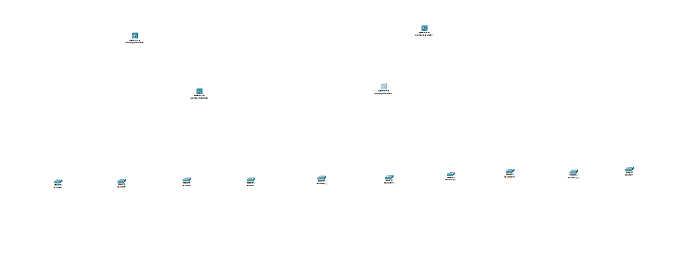

# Proposed enterprise architecture

Status: design baseline established; detailed addressing, platform capability checks and implementation remain in progress.

## Requirements

The fictional technology company operates in Seattle (300 employees), San Jose (150), and Austin (100). It needs shared internal services, secure inter-office communication, department-level access control, public-facing services and resilience to component failures. Least privilege is a design requirement.

## Proposed campus design

Washington headquarters: two Cisco 3560-24PS core switches, two 3560-24PS distribution switches and ten representative access switches. The production capacity assumption was ten 48-port access switches (480 ports); the simulation uses fewer endpoint connections and 24-port access devices. The 2950-24 access switches are retained for functional simulation. Both Gigabit ports on each distribution switch are occupied by routed links, so pilot access uplinks use FastEthernet. The ten switches provide 220 endpoint-facing ports after reserving two uplinks each; this is representative rather than full-capacity deployment.

- Each access switch is intended to connect to both distribution switches with Layer 2 trunks.
- STP prevents Layer 2 loops; prefer distribution switches as roots (proposed base priorities 4096 and 8192).
- Layer 3 SVIs, ACLs and HSRP provide routing, access control and gateway redundancy at distribution. Proposed HSRP priorities: 110 and 100, with preemption on the preferred device.
- Core-to-distribution connections are routed point-to-point links; OSPF is planned. Link speeds and interfaces must account for the limited Gigabit ports on the simulated 3560.
- Branches may use a redundant collapsed-core design.

## Washington implementation decisions

The four core-to-distribution routed links and single-area OSPF are implemented and tested, including controlled link failure and recovery. First dual-uplink access switch trunks are operational. The approved nine-VLAN addressing plan is recorded in [VLAN design and VTP checkpoint](../documentation/WA-vlan-design-and-vtp-checkpoint.md). Nine VLANs are created on DSW-02 only as verified; VTP Transparent mode is proposed but not configured. A direct Layer 2 distribution interconnect and STP design must be evaluated before scaling the redundant access topology. SVIs, HSRP and access-layer failure testing remain pending.

## Proposed WAN and security

Full-mesh logical WAN between Washington, California and Texas with site-to-site IPsec, dual ISP connections and redundant WAN routers. Use dynamic routing where supported by the selected tunnel design. Plan active/standby firewalls between WAN routers and the internal core, with a separate DMZ and default-deny access from the DMZ to inside. Department segmentation uses VLANs and routing-boundary ACLs/firewall policies.

Centralized directory, DNS, DHCP, authentication, logging and monitoring are planned where supported. Cisco Packet Tracer 9.0.1 is the initial platform; real Active Directory and enterprise-grade stateful firewall HA require separate emulation or physical lab validation. All features above are planned unless explicitly recorded as implemented in milestone documentation.

## Visual evidence

### initial switch layout

[Complete screenshot index](../screenshots/README.md)
