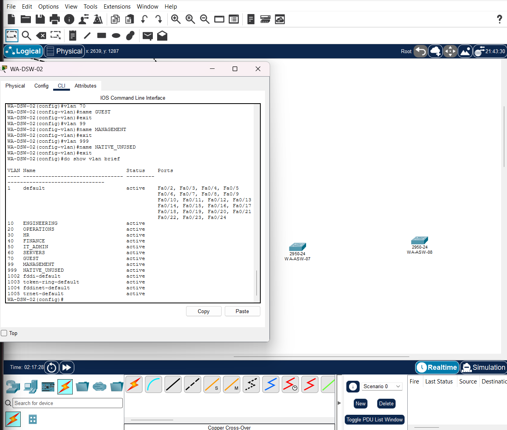
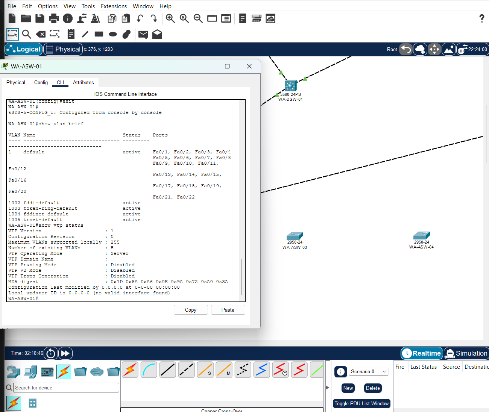

# Washington VLAN design and VTP checkpoint — Step 47

## Approved addressing plan

| VLAN | Name | Intended subnet |
| --- | --- | --- |
| 10 | ENGINEERING | 10.10.10.0/24 |
| 20 | OPERATIONS | 10.10.20.0/24 |
| 30 | HR | 10.10.30.0/24 |
| 40 | FINANCE | 10.10.40.0/24 |
| 50 | IT_ADMIN | 10.10.50.0/24 |
| 60 | SERVERS | 10.10.60.0/24 |
| 70 | GUEST | 10.10.70.0/24 |
| 99 | MANAGEMENT | 10.10.99.0/24 |
| 999 | NATIVE_UNUSED | None |

All nine VLANs created and shown active in WA-DSW-02 CLI output (show vlan brief). No endpoint ports assigned to these VLANs yet. Subnets are planned; no SVIs or default gateways configured for them. VLAN 999 has been created but is not yet configured as the native VLAN on trunks.

## VTP inspection — WA-ASW-01

Commands executed: show vlan brief; show vtp status.

Observed results:
- VTP version 1, operating mode Server, empty domain name.
- Configuration revision 0; five existing VLANs (1, 1002–1005).
- Pruning disabled; VTP V2 mode disabled.
- Nine departmental/design VLANs on DSW-02 are not present on ASW-01.

## Proposed design — not implemented

Use VTP Transparent mode on participating Layer 2 switches, with explicitly managed local VLAN databases, to reduce the risk of unintended automatic database changes. Transparent mode does not automatically apply received VLAN updates; it may forward VTP messages depending on version and configuration. WA-ASW-01 was subsequently configured with `vtp mode transparent`; the user verified `VTP Operating Mode : Transparent` using `do show vtp status`. WA-DSW-02 was then configured with `vtp mode transparent` and the user reported completion after being instructed to verify the mode. A fresh CLI screenshot confirmed WA-DSW-02 in Transparent mode, VTP configuration revision 0, and all nine planned VLANs (10, 20, 30, 40, 50, 60, 70, 99, 999) remain active. Fourteen VLANs exist including five defaults. WA-DSW-01 screenshot has now confirmed Transparent mode, configuration revision 0, and only the five default VLANs (1 and 1002–1005). Departmental VLANs were not present at inspection; subsequent creation was confirmed by the user.

## Resume instructions

Step 48 completed on WA-ASW-01 with user-confirmed verification. Next: create the nine approved VLANs on WA-ASW-01, verify with `show vlan brief`, then check trunk VLAN activation. ASW-01 was previously verified in VTP Transparent mode. Explain only commands not previously reviewed. Inspect and configure VTP policy on both distribution switches, verify local VLAN databases, create missing VLANs where required, then implement controlled trunk VLAN lists, native VLAN consistency, STP, SVIs and HSRP. VLAN propagation, tagged endpoint traffic and Layer 2 failover have not been validated.

## Persistence and evidence

Core and distribution routing configurations were saved at the previous milestone. Saving subsequent trunk, VLAN, and VTP changes has not yet been confirmed. The VTP Transparent confirmation was reported by the user; no new screenshot has been uploaded for this step. Selected CLI screenshots are uploaded and linked below. The Packet Tracer project file is still pending.

## Visual evidence

### DSW 02 VLAN database

### ASW 01 VTP baseline

[Complete screenshot index](../screenshots/README.md)
