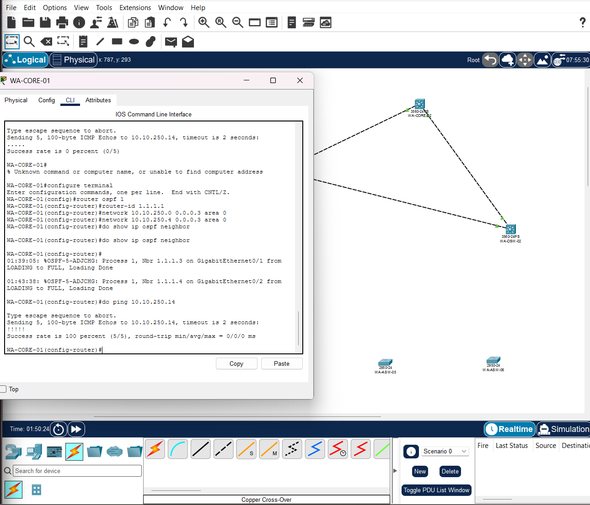
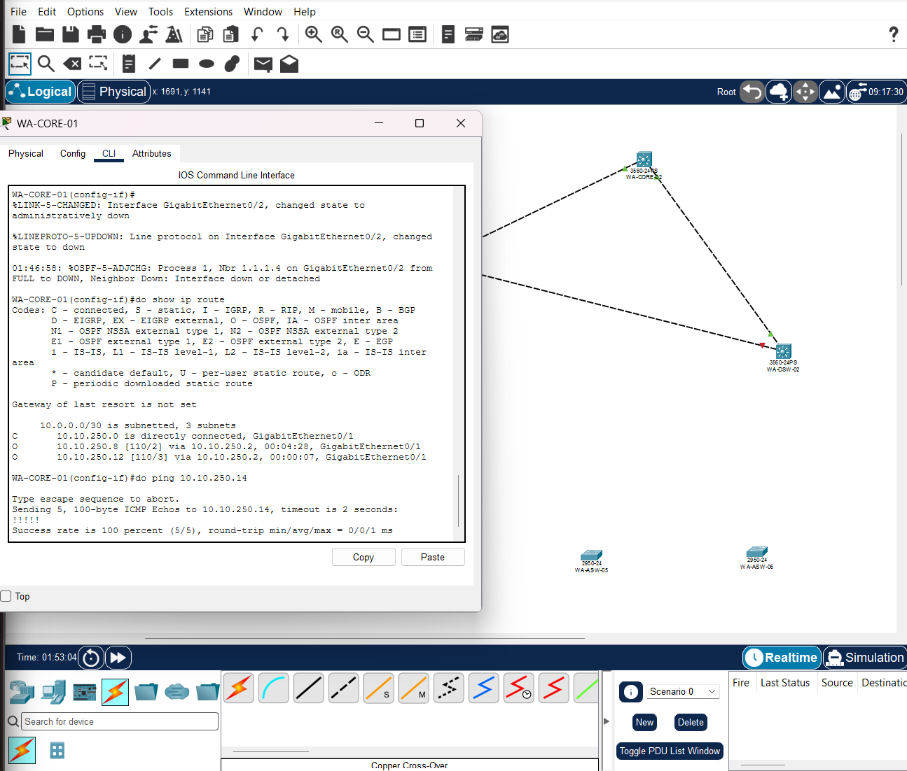
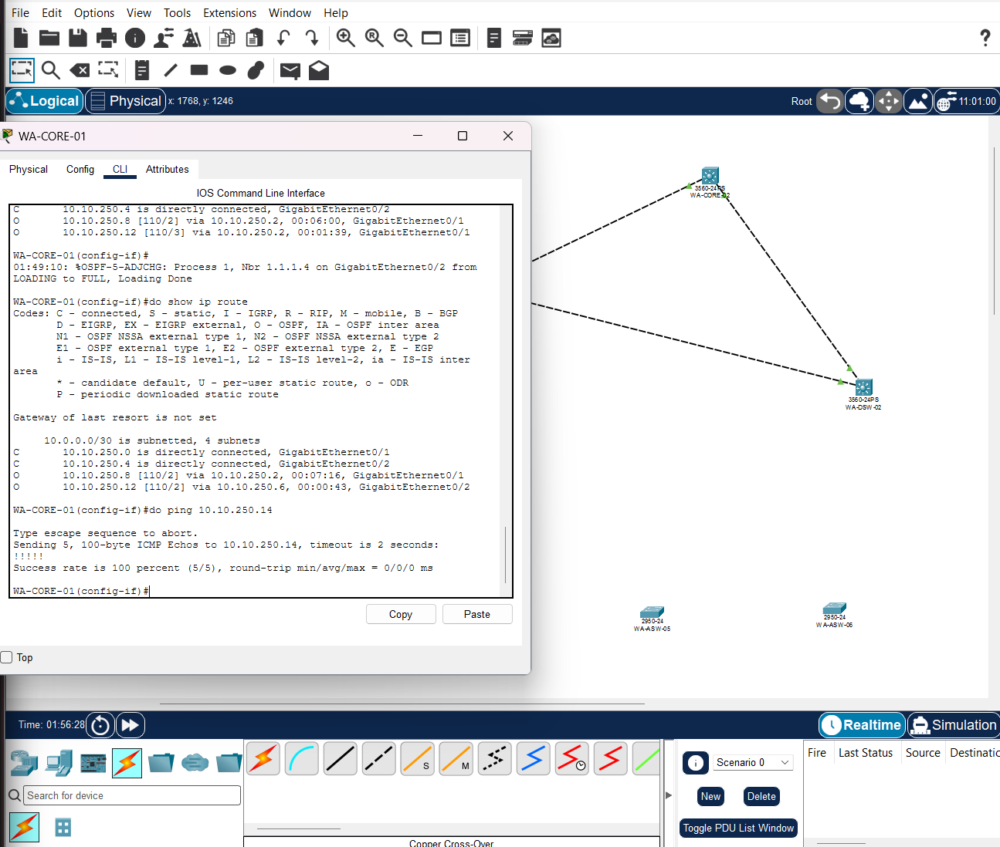
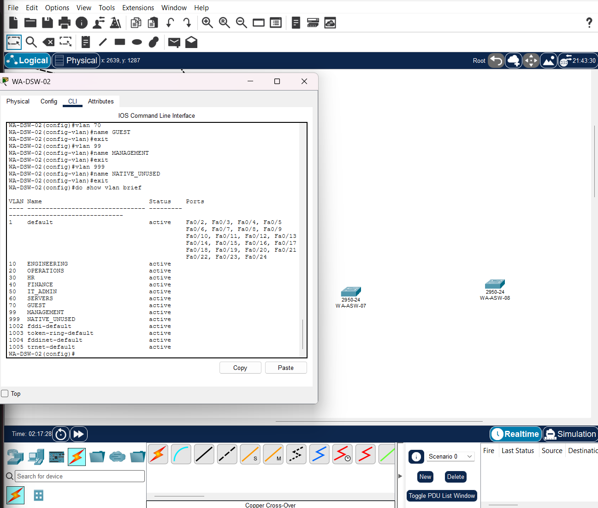
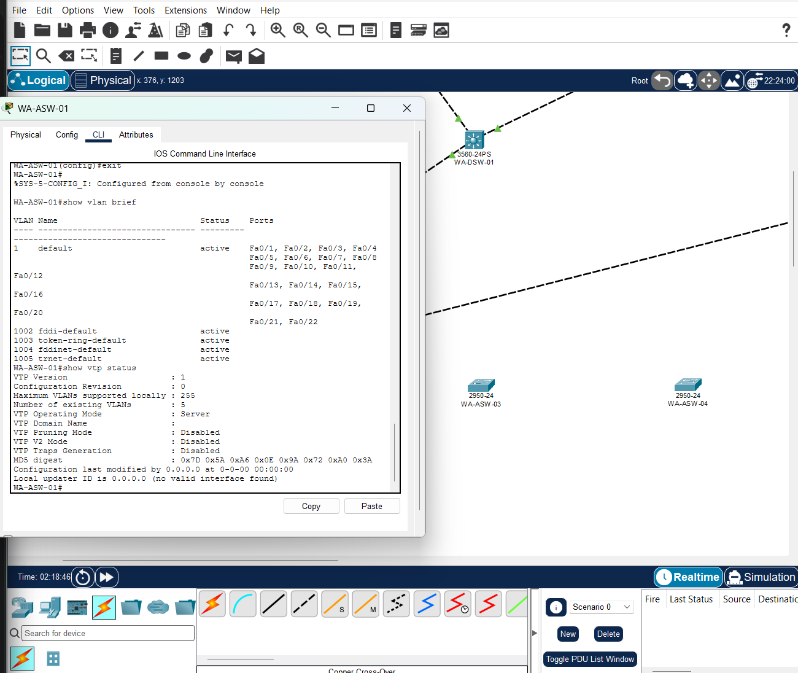

# Project journal

## 2026-11-20 — Project initiation

Defined the initial scope: a fictional three-state enterprise with Washington headquarters and California and Texas branches. Next: establish requirements, select a simulation platform and draft the network architecture. Implementation has not started.

## 2026-11-20 — Architecture baseline and first routed link

Selected Cisco Packet Tracer 9.0.1. Discussed least privilege, VLANs, ACLs, layered campus design, STP, HSRP, OSPF, full-mesh WAN, IPsec, redundant ISPs/routers, firewall HA, DMZ and centralized services. These are design concepts, not completed deployments.

Placed 14 representative Washington switches and configured the first point-to-point /30 link between WA-CORE-01 and WA-DSW-01. Verified both interfaces up/up and corrected self-ping tests. Corrected peer ping from WA-CORE-01 to WA-DSW-01 verified from the supplied screenshot: 5/5, 100% success. Next: review access-switch models and remaining port budget, complete core/distribution links and enable routing.

See [design baseline](../architecture/enterprise-design.md) and [milestone WA-01](../testing/WA-01-routed-link.md).

## Washington headquarters — Four routed links

Completed the four point-to-point /30 connections between the core and distribution switches. All direct peer links passed ping testing; WA-02 recovery was confirmed by the user after restoring its IP address. CDP revealed reversed CORE-02 port assignments relative to the original design, which were corrected without recabling. See [as-built address map](../documentation/WA-routed-link-map.md) and [test results](../testing/WA-core-distribution-validation.md). Next: configure OSPF and validate multi-hop connectivity and failover. Selected screenshots are uploaded and linked below.

## Washington headquarters — OSPF Area 0

Configured process 1 with four unique router IDs and precise /30 wildcard statements. Observed four FULL adjacencies, an OSPF-learned route on DSW-01 (AD 110, cost 2), and successful remote subnet ping from CORE-01 to 10.10.250.14 (0/5 before OSPF, 5/5 afterward). See [configuration](../configurations/WA/03-ospf-area-zero.md) and [validation](../testing/WA-OSPF-validation.md). Next: verify baseline route and test alternate-path recovery. Selected screenshots are uploaded and linked below.

## Washington headquarters — OSPF failover and recovery

Intentionally disabled CORE-01 Gi0/2, observed neighbor 1.1.1.4 transition from FULL to DOWN, and verified alternate route cost 3 via 10.10.250.2. Ping to 10.10.250.14 succeeded 5/5 after convergence. Restored the interface, observed adjacency return to FULL and the original cost 2 route via 10.10.250.6 return automatically. See [test record](../testing/WA-OSPF-failover-recovery.md). Exact convergence time and continuous packet loss not measured. Final recovery ping verified 5/5 (100%), RTT 0/0/0 ms, after the cost 2 route returned. User confirmed saving startup configurations on all four multilayer switches and saving the Packet Tracer project. Next: access-layer design and implementation.

## Washington headquarters — Access-layer pilot and VLAN checkpoint

Retained the 2950-24 access switches due to distribution Gigabit port constraints. Connected WA-ASW-01 to both distribution switches using FastEthernet and explicitly configured all four trunk endpoints; CLI showed 802.1Q trunking, native VLAN 1, allowed range 1–1005. Approved VLANs 10–70 (increments of 10), 99 and 999. Created and verified all nine on WA-DSW-02. Inspected WA-ASW-01: VTP v1 Server, no domain, revision 0, five default VLANs only. Proposed Transparent mode but user stopped before applying it. Resume at Step 48 on WA-ASW-01. New trunk/VLAN configuration saves not yet confirmed. See [checkpoint](../documentation/WA-vlan-design-and-vtp-checkpoint.md) and [trunk record](../configurations/WA/04-first-access-switch-trunks.md).

## Visual evidence

### OSPF before after

### OSPF failover

### OSPF recovery

### DSW 02 VLAN database

### ASW 01 VTP baseline

[Complete screenshot index](../screenshots/README.md)

## Washington headquarters — WA-ASW-01 VTP Transparent verified

Entered `vtp mode transparent` on WA-ASW-01, then ran `do show vtp status`. User confirmed that VTP Operating Mode displays Transparent. The command changes local VTP database behavior, not VLAN interface addressing or trunk status. No VTP Transparent configuration yet verified on distribution switches. New screenshot and configuration save pending. Next: inspect WA-DSW-02 VTP status before choosing the next configuration action. See [VLAN/VTP checkpoint](../documentation/WA-vlan-design-and-vtp-checkpoint.md).

## WA-DSW-02 — VLAN preservation after VTP mode change

CLI screenshot verified `VTP Operating Mode : Transparent`, configuration revision 0, and `show vlan brief` listing all nine planned VLANs active (plus five defaults, total 14). Next device: WA-DSW-01. Original screenshot has not yet been added to the GitHub screenshot gallery.

## WA-DSW-01 — VTP and VLAN inventory verified

Screenshot shows VTP Operating Mode Transparent, configuration revision 0, five default VLANs only. No need to configure VTP mode again. Nine approved VLANs are still absent from WA-DSW-01 and require local creation. Next: implement and verify VLAN database on DSW-01.

## WA-DSW-01 — Nine-VLAN configuration completed

User confirmed completing the nine approved VLANs on WA-DSW-01 after being instructed to create them and verify with `do show vlan brief`. This is user-reported completion; a fresh screenshot has not been received. Both distribution switches are now reported to contain the VLAN plan. Next: create the same VLANs on WA-ASW-01 and validate VLAN activation on both trunks.

## WA-ASW-01 — VLAN database verified

Step 54: Screenshot of `do show vlan brief` confirmed all nine approved VLANs (10, 20, 30, 40, 50, 60, 70, 99, 999) active on the first access switch. No access ports assigned yet. VTP Transparent mode was previously confirmed. Next: verify VLANs active on Fa0/23 and Fa0/24 802.1Q trunks. Latest screenshot is not yet uploaded to the repository.

## WA-ASW-01 — Both trunks carry approved VLANs

Step 55 CLI screenshot verified Fa0/23 and Fa0/24 are 802.1Q trunks, mode on, native VLAN 1. All nine approved VLANs plus VLAN 1 were present in both allowed-and-active and STP-forwarding/not-pruned listings. An unsupported `show interface trunk brief` attempt was corrected to `do show interface trunk`. The evidence proves access-side trunk VLAN availability, not end-to-end connectivity or link-failure redundancy. Next: inspect STP for a single VLAN. New screenshot is not yet uploaded.

## WA-ASW-01 — VLAN 10 STP baseline

Step 56 CLI screenshot: spanning-tree protocol IEEE, root ID priority 32778 and MAC 0001.43C9.5CCD; local Bridge ID priority 32778 and MAC 0001.C9D7.6A60. Fa0/24 is Root/FWD (cost 19), Fa0/23 Designated/FWD. No blocked ports visible on ASW-01 for VLAN 10. Next: inspect WA-DSW-02 `show spanning-tree vlan 10` to confirm which bridge is root before changing priorities. [STP record](../testing/WA-STP-vlan10-baseline.md). Latest screenshot awaiting separate upload.

## WA-DSW-01 — VLAN 10 primary STP root configured

Step 59 verified with screenshot: entered `spanning-tree vlan 10 priority 4096`; WA-DSW-01 then reported Root ID priority 4106, MAC 0030.F2B6.B95D and `This bridge is the root`. Fa0/1 transitioned from Root/FWD to Designated/FWD. Next: set and verify the secondary root priority on WA-DSW-02, then plan the distribution Layer 2 interconnect. See [STP test record](../testing/WA-STP-vlan10-baseline.md).
