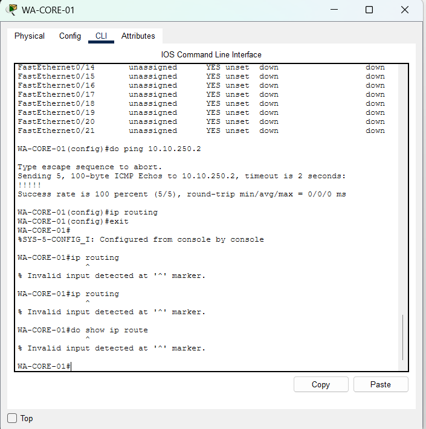

# Test WA-01 — Direct routed link connectivity

Date: 2026-11-20 (local time)

| Test | Expected | Observed |
| --- | --- | --- |
| Routed port mode (CORE-01) | Switchport disabled | Confirmed by user CLI output |
| CORE-01 Gi0/1 | 10.10.250.1, up/up | Confirmed in screenshot |
| DSW-01 Gi0/1 | 10.10.250.2, up/up | Confirmed in screenshot |
| DSW-01 ping CORE-01 | ICMP replies from 10.10.250.1 | Success reported by user | 
| CORE-01 ping DSW-01 | ICMP replies from 10.10.250.2 | Verified in supplied screenshot: 5/5, 100% success, 0% loss |

Correct command on WA-DSW-01 in configuration mode:

```text
do ping 10.10.250.1
```

Earlier screenshots show successful self-pings (CORE-01 to .1 and DSW-01 to .2), which do not validate peer connectivity. Those were corrected during the lab. Do not attribute their 5/5 results or latency to the peer test.

Verified CLI evidence (transcribed from the supplied screenshot):

```text
WA-CORE-01(config)#do ping 10.10.250.2
Sending 5, 100-byte ICMP Echos to 10.10.250.2, timeout is 2 seconds:
!!!!!
Success rate is 100 percent (5/5), round-trip min/avg/max = 0/0/0 ms
```

Status: PASS — interface checks and CORE-01 to DSW-01 peer connectivity verified. Selected screenshots are uploaded and linked below. No multi-hop routing or failover tests performed.

## Visual evidence

### 01 peer ping



[Complete screenshot index](../screenshots/README.md)
