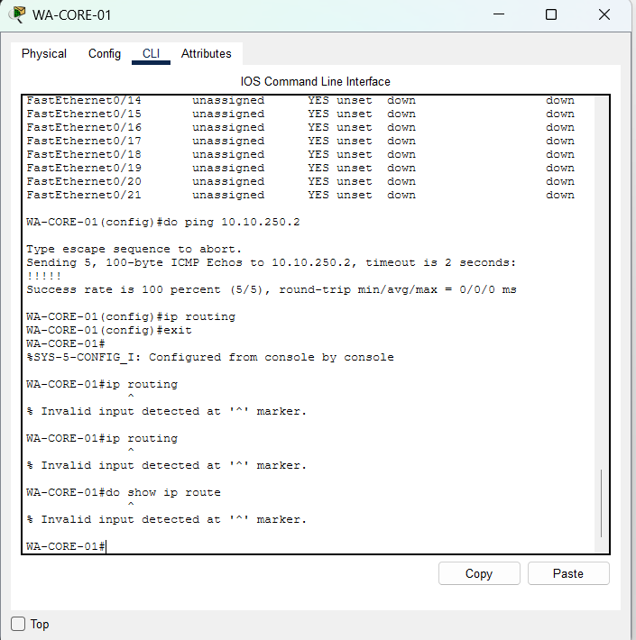
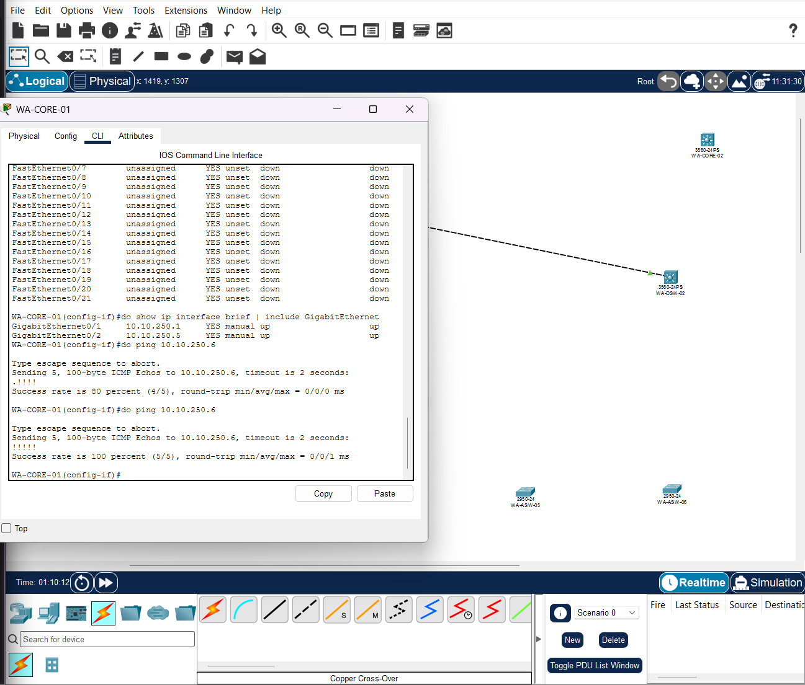
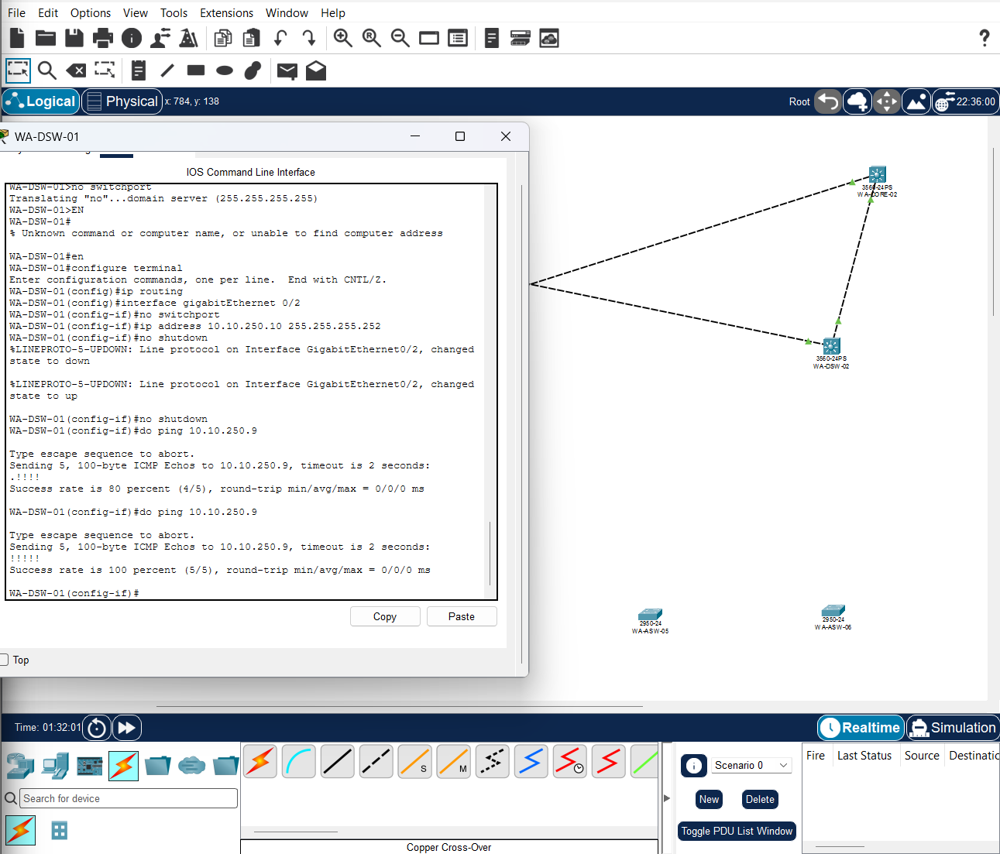
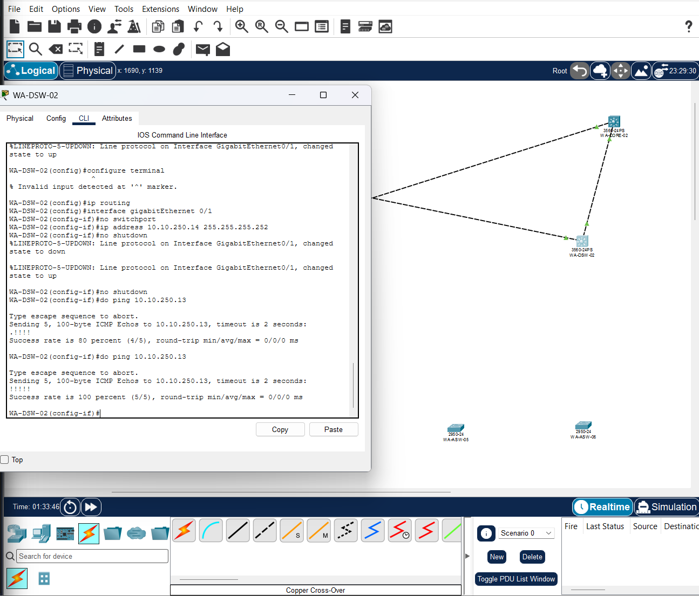

# Washington routed infrastructure validation

| Link | Test source | Destination | Initial result | Repeat / final |
| --- | --- | --- | --- | --- |
| WA-01 | WA-CORE-01 | 10.10.250.2 | 5/5 | 100% screenshot verified |
| WA-02 | WA-CORE-01 | 10.10.250.6 | 4/5 | 5/5 screenshot verified before later misconfiguration; recovery reported successful |
| WA-03 | WA-DSW-01 | 10.10.250.9 | 4/5 | 5/5 screenshot verified |
| WA-04 | WA-DSW-02 | 10.10.250.13 | 4/5 | 5/5 screenshot verified |

Final WA-04 CLI transcription:
```text
WA-DSW-02(config-if)#do ping 10.10.250.13
Sending 5, 100-byte ICMP Echos to 10.10.250.13, timeout is 2 seconds:
!!!!!
Success rate is 100 percent (5/5), round-trip min/avg/max = 0/0/0 ms
```

Initial packet loss followed by successful repeat is consistent with ARP resolution, but ARP was not captured to establish causation. These tests validate direct peer connectivity only. OSPF adjacency, multi-hop forwarding and alternate-path convergence remain pending. Selected screenshots are uploaded and linked below.

## Visual evidence

### 01 peer ping


### 02 peer ping


### 03 peer ping


### 04 peer ping



[Complete screenshot index](../screenshots/README.md)
